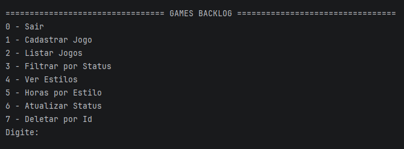
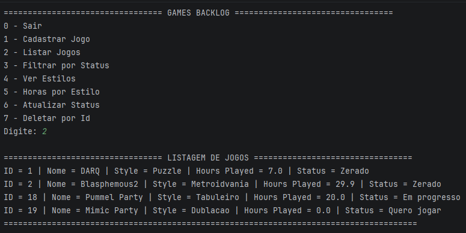

# Games Backlog

Sistema de console em Java para organizar sua biblioteca de jogos: cadastre jogos, acompanhe o status de cada um e veja estatísticas, tudo salvo em um banco MySQL.

## Funcionalidades

- Cadastrar jogos (nome, estilo, horas jogadas e status)
- Listar todos os jogos
- Filtrar por status (Quero jogar, Em progresso ou Zerado)
- Ver os estilos de jogo que existem na biblioteca, sem repetir
- Ver o total de horas jogadas por estilo
- Atualizar o status de um jogo
- Deletar um jogo pelo id
- Validação das entradas (números, status) e tratamento de erros do banco

## Tecnologias e conceitos

- **Java 17**
- **MySQL** e **JDBC** (CRUD com `PreparedStatement`)
- **Generics** (`List<Game>`), **Set** e **Map** para as estatísticas
- **Lambda e Streams** para os filtros
- Padrão **DAO** e exception própria (`DbException`)
- Organização em packages: `application`, `dao`, `db` e `entities`

## Como rodar

1. Clone o repositório.
2. Baixe o **MySQL Connector/J** e adicione ao projeto (no IntelliJ: `File > Project Structure > Libraries > +`).
3. Rode o arquivo `schema.sql` no MySQL para criar o banco e a tabela.
4. Copie o arquivo `db.properties.example` para `db.properties`, na raiz do projeto, e coloque a sua senha do MySQL.
5. Execute a classe `Main`.

## Prints

## Autor

Pedro Gomes - [LinkedIn](https://www.linkedin.com/in/pedrogomes-dev/)